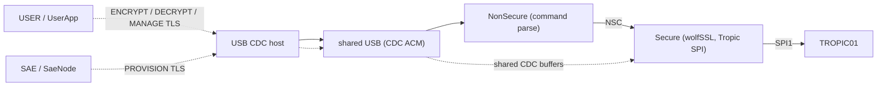

# SE_firmware

TrustZone firmware for **STM32U535** (TS13 DevKit) with a **TROPIC01** secure element.

- **Secure** — wolfSSL TLS 1.3 client, libtropic / SPI to TROPIC01, NSC API, MCU NV
- **NonSecure** — USB CDC ACM frames (`0x00` command / `0x01` Secure); parses commands and forwards Secure payloads via NSC. After arming, type `0x01` is the TLS byte stream.

Boot path: Secure init → jump to NonSecure at `0x08030000` → USB enumerates as CDC ACM.



Only one host process owns CDC at a time. **USER** (UserApp) is encrypt / decrypt / manage.
**SAE** (SaeNode) is provision. UserApp is not an SAE.

PIN for provisioned OTP never appears on USB. The console only arms a mode and a Unix time; PIN and payloads ride inside TLS after the handshake.

---

## Documentation

| Doc | Contents |
| --- | --- |
| [docs/HOW_TO_RUN.md](docs/HOW_TO_RUN.md) | First flash vs later sessions (silicon) |
| [docs/COMMANDS.md](docs/COMMANDS.md) | USB console syntax and MANAGE commands |
| [docs/COMMUNICATION.md](docs/COMMUNICATION.md) | USB/NSC pipe, TLS 1.3, LV uplink/downlink, OTP records |
| [docs/TROPIC.md](docs/TROPIC.md) | R-MEM slots, dual cursors, MCU NV, M&D, classical vs PQC |
| [docs/security_analysis.tex](../docs/security_analysis.tex) | Security analysis: threat model, controls, residual risks |
| [docs/ACCESS_POINTS.md](docs/ACCESS_POINTS.md) | SAE and SE interfaces to review |
| [docs/HARDWARE.md](docs/HARDWARE.md) | Flash/RAM map, option bytes, pins, GTZC |
| [host/README.md](host/README.md) | WSL2 TROPIC01 model tests and `se_host` |

---

## Layout

```text
Secure/                  Secure world (TLS, Tropic, NSC, MCU NV)
NonSecure/               USB CDC + host command parsing
Secure_nsclib/           NSC headers shared with NonSecure
libtropic/               Vendored TROPIC01 SDK (read-only)
host/                    Model tests + se_host — see host/README.md
docs/                    Firmware documentation (this index)
scripts/                 Host verify helpers (session uplink)
```

## License

Original code in this tree is Apache-2.0. Third-party terms are collected in [LICENSE.txt](LICENSE.txt). HAL is BSD-3-Clause, CMSIS is Apache-2.0, libtropic is Clear BSD, nanopb is zlib-style, USBX is the Microsoft Azure RTOS license, and wolfSSL is GPLv3 or later unless you have a commercial wolfSSL license.

Secure and NonSecure are separate images. The Secure image links wolfSSL and is conveyed under GPLv3. The NonSecure image links USBX and stays under the Microsoft terms. See [LICENSE.txt](LICENSE.txt).
